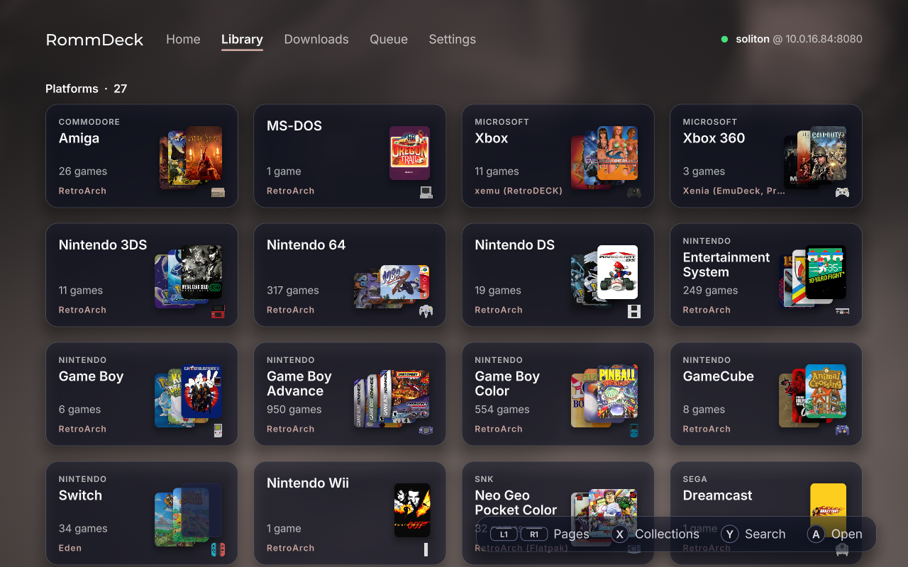

# RomM Server Client for the Steam Deck


A [RomM](https://romm.app) companion client for the Steam Deck based on my client for the PS5 (RommPS). This app is meant to finally bridge the feature gap on the Steam Deck when it comes to syncing and downloading from a RomM server. Our aim is to support syncing saves for as many platforms as possible without complicated configurations. RommDeck handles as much as it can for you automatically, such as detecting which emulators you have installed and setting up to sync your games and saves to the appropriate folders. Its app has a modern and beautiful UI, and acts as a easy to navigate library and control center for your RomM needs on the Steam Deck.

- **Save and state sync**
  - Monitors save file changes in the background, and uploads them as soon as they've changed. Periodic syncs also ensure that your Deck always has the latest saves and save states.
  - A game's saves come down the moment it finishes downloading, so it's ready to play.
  - Save states only come down to an emulator that can load them (see [Save states](#save-states)).
  - Optional: turn save sync off in setup or Settings to use RomM just for games.
- **See what synced**
  - An activity log and every save and state kept in sync, by platform, in the app and the Web UI. Settle conflicts and restore older versions from either.
  - Settings > Diagnostic bundle saves the logs for a bug report, with your server, names and addresses left out.
- **Interactive library**
  - Browse your RomM library from the RommDeck app (or some other device via the Web UI), download games and BIOS files into the right emulator folders, and resolve save conflicts.
- **BIOS and System File Sync**
  - Get the BIOS files and system data you need to run your emulators properly.
- **Pluggable emulator profiles and multiple emulators per platform**
  - Fully customizable sync destinations, but includes frequently updated preset profiles for RetroDECK, EmuDeck and standalone emulators. 
  - Can sync games and saves and states for multiple emulators per platform (PS2 on RetroArch and PCSX2 as an example), sharing one copy of each game.
- **Beautiful and Responsive UI**
  - Modern, responsive, and frankly great to use if I say so myself. Has various themes and sounds to choose from.
- **Background Service**
  - All operations are handled by a background service, which means syncing, downloading, and updating keep working with the app closed, so you can keep **gaming**.
- **RomM API Compliant**
  - RommDeck is meant to strictly stick to RomM's API and method of syncing saves and states, ensuring we don't break anything and support RomM's latest features.
- **Secure and Human-Coded**
  - This app was primarily coded by a **human**, and will be frequently updated and maintained. AI was primarily used for explaining concepts, creating documentation, and converting data. Ya know, the tedious stuff. AI may be used by other contributors to create fixes or new features, but all code is and always will be reviewed by me.
- **Easter Eggs**
  - Check in the Settings, scroll the settings list, see if you find the X. This **hint** won't be here forever.

## Requirements

- A Steam Deck
- RomM 5.2.0 or newer (may work on older versions)
- Whichever other emulators you want
  
## Install

Grab everything from the [releases page](https://github.com/s0liton/RommDeck/releases), in Desktop Mode. Pick one:

### Installer
- Download `RommDeck-Installer.desktop` from the latest release, double-click it, and let KDE run it when it asks.
- It puts the latest RommDeck in `~/Applications`, starts the background service, and adds RommDeck to the app menu and to Steam with its artwork (Steam restarts for that, it asks first).
- Run it again later to update or uninstall.

### AppImage
- Download the AppImage, right-click it, Properties, Permissions, tick **Is executable** (or `chmod +x` it), then run it.
- The first launch installs and starts the background service. The setup wizard's last step adds RommDeck to Steam for Game Mode.

### Tarball
- For the terminal crowd. Download `rommdeck-<version>-x86_64.tar.gz`, extract it, and from the extracted folder run:
  ```sh
  ./install.sh --steam
  ```
- That installs RommDeck in `~/.local/share/rommdeck`, adds it to the app menu, and (with `--steam`) to your Steam library. Steam closes for a moment while it does, it's the only way Steam lets anyone touch its shortcuts.

### Updates
- **Installer:** run it again and pick **Update**.
- **AppImage:** run the new one, it updates the background service on launch. Gear Lever or AppImageUpdate can update it in place too.
- **Tarball:** extract the new one and run `./install.sh` again.

Your settings and pairing (`~/.local/share/romm-sync`) stay put either way.

### Uninstall
Run the installer and pick **Uninstall**. It asks before it removes your settings and pairing. Remove the Steam shortcut by hand if you installed some other way.

### How it Works

Once installed, RommDeck runs a background service that syncs your saves on schedule, as well as when emulators are opened and closed. Any time a game is opened or closed, a sync runs if your settings allow it. The RommDeck app is your single pane of glass to do everything. Download games, browse collections, sync saves, resolve conflicts, and more. When you download a game, RommDeck downloads any required firmware and files, as well as any saves associated.

## Setup Wizard

The setup wizard walks you through five steps:

1. Connecting to your server.
2. Approving the Deck in RomM, by scanning a QR code or entering a code.
3. Choosing which emulators to sync.
4. Checking what the first sync will do.
5. Choosing when to sync in the background.

**Back up your saves before the first sync.** Copy your emulator save folders to a computer or USB drive. RommDeck keeps a local copy before replacing any file, but your own backup is the safest option.

## Emulators
RommDeck has built-in profiles for most known emulators on the Steam Deck, and will set the correct default game, save/save state, and bios directories for them. You can set each platform's save and rom directories manually if you wish, but you'll find the pre-built profiles much easier. It also supports EmuDeck and RetroDECK setups.

### Save states
Some users have recently reported issues with being able to pull down save states from their servers. They don't see them on the destination save folder for that emulator, or if they do, they don't work. Save states typically cannot be used across different emulators (cores), and even within the same core, the definition of a save state may different with the file version, and version of the app. In my opinion, save states should be for quick resume or to save you when you forgot to save your game, so they truly don't need to be synced across devices.

PSP, GameCube and Wii saves are synced as one zip per game, the same format other RomM clients use.

## Web UI

RommDeck exposes a separate Web UI at http://your-deck-ip:8780 where you can access all the same features present in the native app.

## Building (Where is the code?!)

RommDeck is based on the codebase of my PS4/PS5 homebrew RomM client, [RommPS](https://github.com/s0liton/RommPS). If you want to build it yourself, that repo has everything you need to build for the Deck. I am working on splitting out the core code into it's own repo, so that will make things a bit more organized eventually.

## Watch Development Progress

I've started streaming the development of this app as well as other side projects on my YouTube channel. Nothing serious, but you can catch me live streaming. ;)

[My Channel](https://www.youtube.com/@soliton_radar)

## P.S to the industry

If buying isn't **owning**, then piracy **isn't** stealing. 🖕

## Shameless Plug

<a href='https://ko-fi.com/M7G128GENT' target='_blank'></a>

## License

GPL-3.0. The UI kit is GPL-3.0 too, SDL3 is zlib licensed, and libchdr and its zstd decoder are BSD-3-Clause. [cJSON](https://github.com/DaveGamble/cJSON) and [qrcode-generator](https://github.com/kazuhikoarase/qrcode-generator) are MIT licensed. [Monocypher](https://monocypher.org) is CC0 or BSD-2-Clause. [argosy-sigil](https://github.com/rommapp/argosy-sigil) is MPL-2.0, with [tiny-AES-c](https://github.com/kokke/tiny-AES-c) (Unlicense).

The menu sounds are Konami's, used with permission, and not under RommDeck's license. Every part and its license text ships in `licenses/` beside the app.
